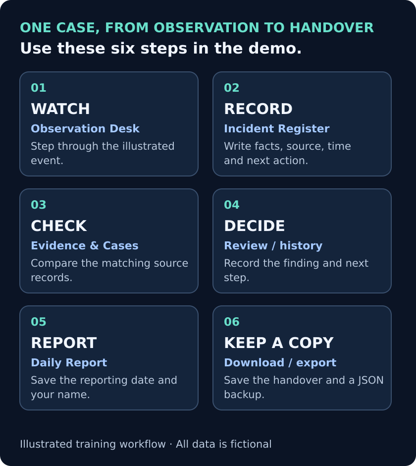
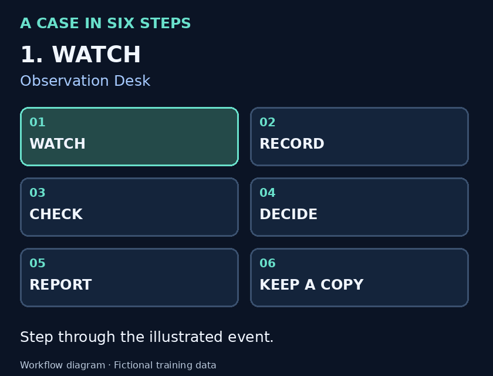
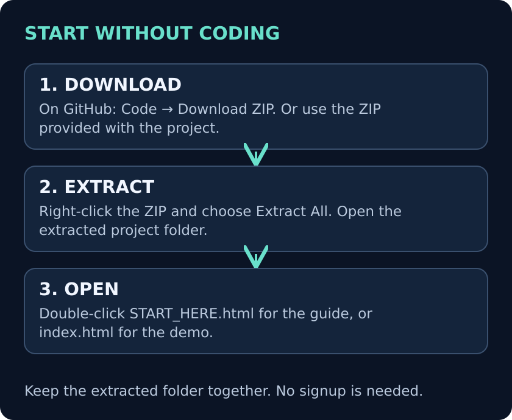
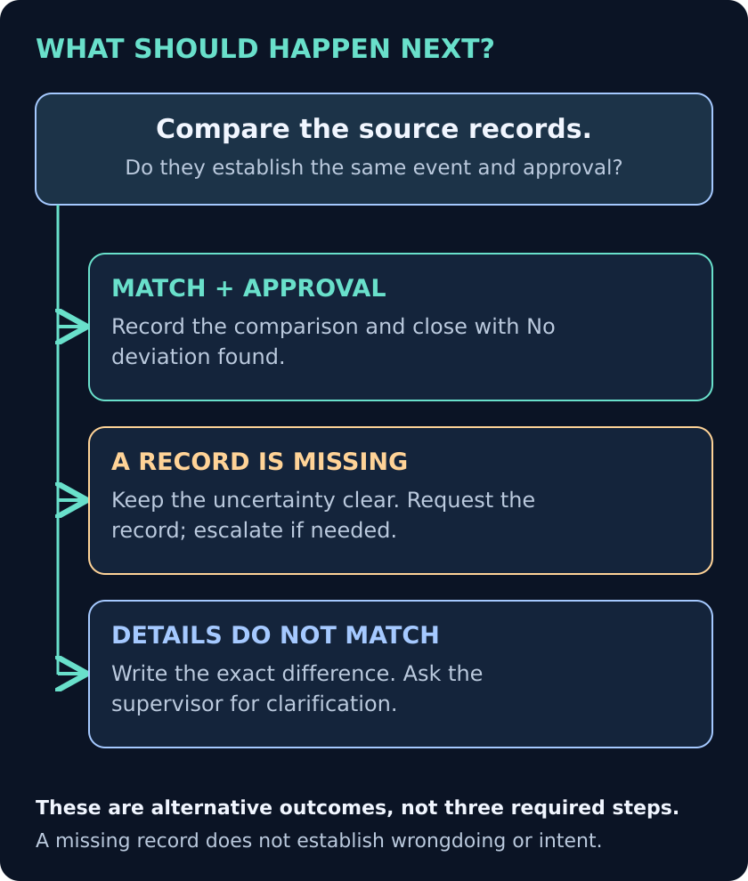
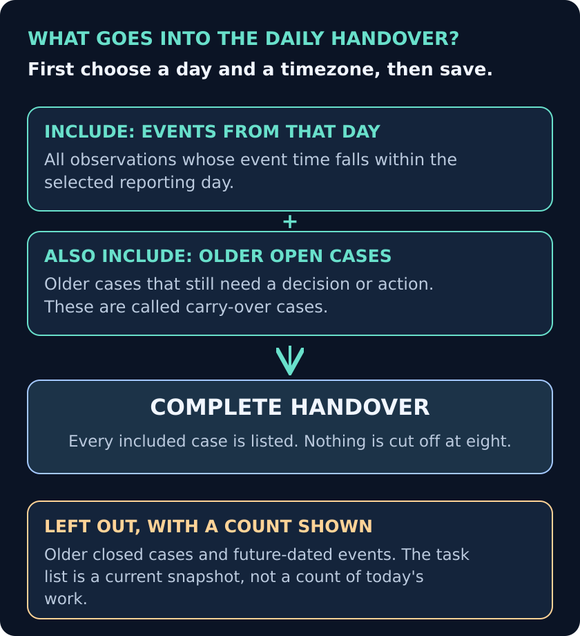

# Retail QA Watchtower

**A practice tool for checking store incidents and writing a clear handover report. No coding is needed to try it.**

Quality assurance (**QA**) means checking whether work was done correctly and recording what you found. This demo lets you watch an illustrated event, write down the facts, compare the paperwork and decide what should happen next.

> **Everything here is fictional.** The stores, events, records and training rules are made up. This is an independent, AI-assisted portfolio project—not work commissioned or endorsed by Active8 Wireless or Metro by T-Mobile. There is no real CCTV or personal customer/employee data.

**Jump to:** [Open the demo](#open-the-demo) · [Follow one case](#follow-one-case) · [Try another example](#try-another-example) · [Plain-English terms](#plain-english-terms) · [Get help](#get-help)

*Click a diagram to open a larger version. These are explanatory diagrams, not application screenshots.*

<strong>Watch the animated workflow overview</strong>

The animation repeats. The numbered diagram above provides the same information without movement.

## Open the demo

1. **Download the project ZIP.** On GitHub, use the green **Code** button, then **Download ZIP**. You can also use the ZIP supplied with this project.
2. **Extract the ZIP first.** On Windows, right-click it and choose **Extract All**. Open the extracted project folder and keep its files together.
3. **Double-click START_HERE.html** for the clickable beginner guide. To go straight to the working demo, double-click **index.html**.

No account, payment, installation or internet connection is needed to try the downloaded demo. A browser such as Chrome opens the HTML files. Opening an HTML file inside GitHub shows its source; download and extract the folder to use it.

**What makes this interactive?** On GitHub, expand the examples and help sections below, use the jump links and enlarge the diagrams. In the downloaded **START_HERE.html** guide, use **Next / Back**, choose a step and try a practice decision. The application itself contains the working forms, records and reports.

## Follow one case

Try this short exercise: **Was a package leaving the store an authorized transfer?** Use the fictional example dated **24 October 2026**. The starting dataset already includes a completed version; your practice entry creates an additional observation.

### 1. Watch what happened

Open **Observation Desk**. Find **Authorized package transfer** and press **Next frame** or **Play sequence**. Then select **Write observation**.

Record what the sequence establishes. A package passing an exit is not, by itself, evidence of theft.

### 2. Write the observation

In **Incident Register**, the example supplies the store, camera, date, time and timezone. The notes are blank so you can write your own account.

| Field | What to enter for this practice case |
|---|---|
| Recorded by | **Demo Learner**, or another clearly fictional name. |
| Observable facts | Describe the package crossing the marked exit. Avoid guessing the person's intention. |
| Evidence needed / next action | Compare the exit record with the approved dispatch record. |
| Evidence state | Leave **Needs verification** until you have checked the records. |

Select **Save timestamped observation**. A confirmation tells you it was saved. If an error appears, correct it before continuing.

### 3. Check the matching records

Open **Evidence & Cases**, then expand **DISPATCH-607** and **EXIT-607**. A dispatch record is the paperwork authorizing a package to move.

| Compare | What the supplied records show |
|---|---|
| Package reference | Both identify **PKG-303-07**. |
| Quantity | Both show one package. |
| Destination | Both identify **Demo Hub B**. |
| Movement time | Both identify **18:05 UTC**, which is **11:05** in the example store's Los Angeles timezone. |
| Approval | Approval at **17:50 UTC** came before the movement. |

### 4. Record the result

Return to your new entry in **Incident Register** and select **Review / history**.

- Enter the reviewer's demo name.
- Select **DISPATCH-607** and **EXIT-607** as supporting records. On a computer, hold **Ctrl** (Windows/Linux) or **Command** (Mac) while selecting both.
- Explain the matching details in **Verification finding**.
- Choose **No deviation found**, set the workflow to **Resolved**, and record the **Resolution outcome** and **Reason / result for this update**.
- Select **Save review and history**.

For this fictional case, the records support an authorized transfer. The app keeps the original observation and adds who reviewed it, the result and the review time.

### 5. Prepare the handover

Open **Daily Report**. Enter a demo name, choose **24 October 2026** and the reporting timezone, then select **Save report settings**. A timezone tells the app which part of the world defines the reporting day.

Choose **Download .txt report** for a readable text file, or **Print / Save PDF** for a printable copy. Every included case is listed; the report does not stop after eight incidents.

### 6. Keep a copy

Use **Export JSON backup** to save a complete copy of the local records and history. This backup is for safekeeping and inspection; the demo does not have a button that automatically restores it.

For examples, open the [sample handover report](docs/SAMPLE_HANDOVER.txt) or [worked case files](docs/CASE_FILES.md).

## Try another example

Click an example to reveal its comparison and next action. These are fictional answer keys, not client results or independent assessments.

<strong>A large discount: does an absent approval prove a violation?</strong>

**Check:** The transaction is $200 before an $80 discount. The customer pays $120. The discount is **$80 ÷ $200 × 100 = 40%**.

The fictional training rule requires approval for discounts above 20%. The supplied approval extract has no matching entry, but it is only a limited extract.

**Next step:** Request the missing approval. If it needs a supervisor, record their name or role and why you are sending it to them. An absent record in this extract does not prove that approval never existed.

**Where to practice:** **QA Task Queue → DISC-441 → Review task**. Inspect **POS-441** and **APPROVAL-INDEX-441** in **Evidence & Cases**.

<strong>A return: the amount matches, but does the item match?</strong>

**Check:** The receipt lists **PHONE-CASE-A**. The related return lists **CHARGER-B**. The transaction reference, quantity and $25 amount match; the item codes do not.

**Next step:** Record the exact mismatch and ask for clarification before calling the return fully checked. Do not infer intent.

**Where to practice:** **QA Task Queue → RET-120 → Review task**. Inspect **RECEIPT-120** and **RETURN-120** first. If you choose **Needs escalation**, enter the recipient and what they need to clarify.

<strong>Test your judgment with six practice questions</strong>

Open **Judgment Exercise**, select your answers and choose **Check answers**. You receive a score and explanations. This is practice, not a qualification or proof of job readiness.

## Plain-English terms

| Term in the app | What it means |
|---|---|
| Observation / incident | An event worth recording or checking. It is not automatically wrongdoing. |
| Supporting record / evidence | The paperwork or log used to check what happened. Every supplied record is fictional. |
| Needs verification | More checking is needed before reaching a conclusion. |
| Corroborated by records | The selected records support the stated facts. Say exactly what they support in the written finding. |
| No deviation found | The checked event shows no difference from the applicable fictional rule. |
| Escalated | Sent to a supervisor or other authorized person for action. |
| Resolved / disposition | A recorded outcome explains how the case was closed. |
| Carry-over | An older case that is still open and needs attention. |
| Handover | A report helping the next person understand what happened and what still needs action. |
| UTC | A common time reference for comparing records from different timezones. |
| CSV | A table file that can be opened in a spreadsheet program. |
| JSON backup | A complete, structured text copy of the records and their history. |

## Get help

<strong>I can see code instead of the demo</strong>

On GitHub, HTML files are shown as source code. Download the ZIP, extract it and open **START_HERE.html** or **index.html** from the extracted folder. If a text editor opens, right-click the file and choose **Open with → Chrome** or another browser.

<strong>The app cannot save, or says “Temporary session”</strong>

Do not assume the entry has been saved. Read the message; the form keeps your draft when saving fails. You can retry or explicitly choose **Use temporary session**.

In a temporary session, changes exist only in that tab. Export a **JSON backup** and any report you need before closing it. Different browsers handle saving from directly opened files differently.

<strong>My totals differ from the daily report</strong>

The top cards summarize the whole register. The daily report uses your selected date and timezone, plus older unresolved cases. Older closed cases and future-dated events are excluded with a count shown. The task list is a current snapshot, not a count of work completed that day.

<strong>I want to start again, or I found a recovery warning</strong>

**Reset synthetic demo** restores the fictional starting records after confirmation. Earlier local operations remain in the backup history; reset is not secure deletion.

If stored data cannot be read, use **Export recovery data** first. Do not clear browser data if you still need it. An older demo can be explicitly migrated, but old evidence and closure labels must be checked again.

<strong>I want to open a CSV in a spreadsheet</strong>

Import its columns as **text**, especially if any entries came from someone else. Spreadsheet programs can interpret some text as formulas. The app adds a protective text prefix to formula-like values, but handling varies among spreadsheet programs and after saving/reopening. The JSON backup preserves the original values.

## For reviewers and developers

The application checks passed: **30 checks of the data rules and 37 browser checks**. Execution records and limits are included. GitHub also runs the checks when changes are published. See [validation evidence](docs/VALIDATION.md), [the test plan](docs/TEST_PLAN.md), [review fixes](docs/REVIEW_RESOLUTION.md) and the [technical guide](docs/TECHNICAL_GUIDE.md).

The four diagrams and animation are included in **docs/images/**. The [documentation checks](docs/DOCUMENTATION_CHECKS.md) record the checks of this guide, its images and links.

This self-created, AI-assisted training prototype does not connect to live cameras, identify people, use real company systems or prove reduced losses. Local records can be changed by the device owner; this is not a tamper-proof production evidence system. Actual employer rules and evidence procedures must come from the employer.
